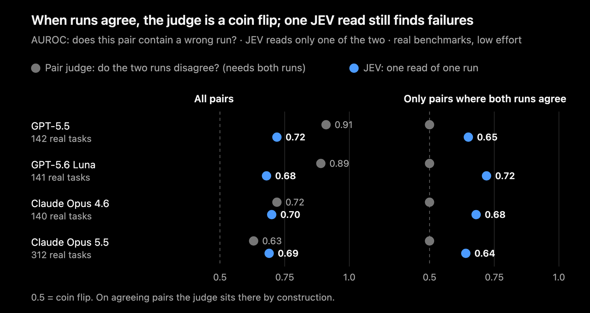
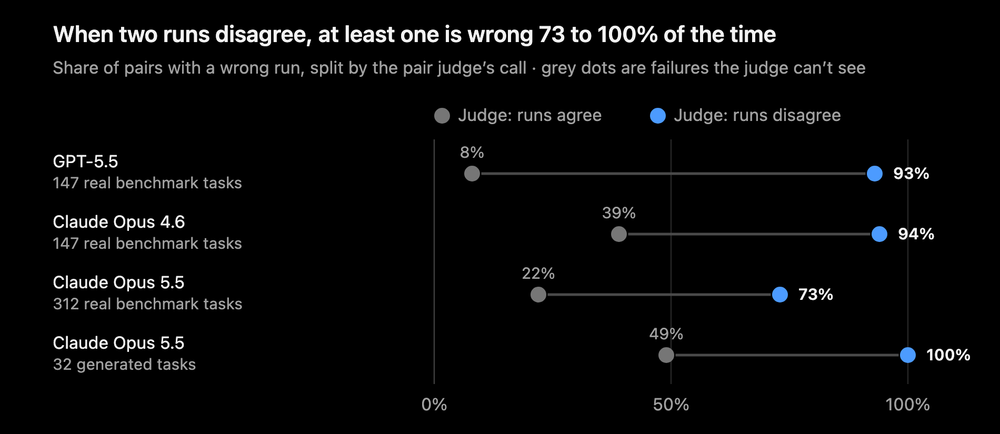
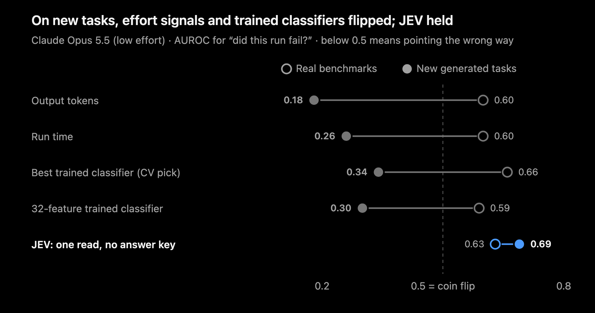
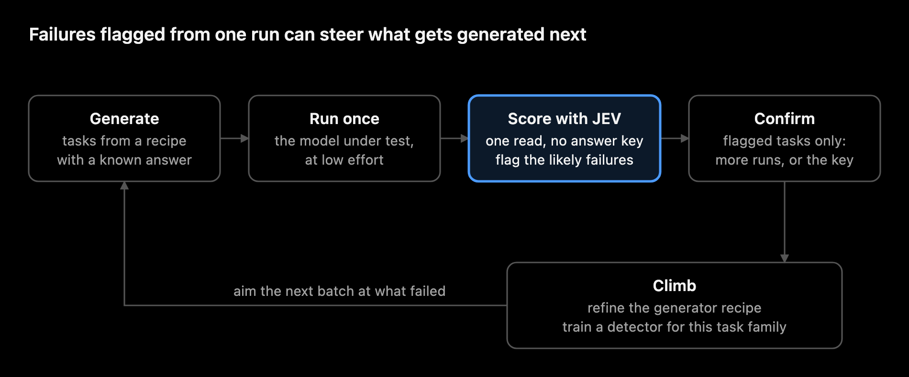

# one-run-no-key

Find likely failures in AI agent runs from **one run**, with **no answer key**.

Give it the task, the agent's visible work and its final answer. One read by [JEV](https://docs.typesafe.ai) returns the probability that the answer is right, at about $0.00015 per run. Because it needs only one run, it works on traces you already have.



What we found on four frontier models (GPT-5.5, GPT-5.6 Luna, Claude Opus 4.6, Claude Opus 5.5, all at low effort):

- **Asking twice works, with a catch.** When two runs of the same task disagree, at least one is wrong 73 to 100% of the time (measured on GPT-5.5 and both Claude models). But you need the second run. And when the two runs agree, a disagreement check has nothing to go on; it is a coin flip.
- **One JEV read breaks the tie.** On pairs where both runs agree, one read of one run still ranks the failing ones higher: AUROC 0.64 to 0.72 on all four models, where the judge sits at 0.50.
- **Fancier didn't transfer.** Classifiers trained on effort, entropy and other signals looked good on the training benchmarks and flipped below chance on new tasks. The plain read held.

Full numbers are in [`results/post_numbers.json`](results/post_numbers.json). This repo lets you check whether it holds on your tasks.

**AUROC**, used throughout: pick one failing run and one correct run at random. AUROC is the chance the score rates the failing one as riskier. 0.5 is a coin flip, 1.0 is perfect.

## How it works

1. **Ingest** your agent logs (Codex, Claude Code, or your own) into `runs.jsonl`: the task, each visible step and the final answer.
2. **Score** each run with one JEV read. `risk = 1 - P(correct)`. JEV sees the task and the run's visible history, ending with the final answer. It never sees an answer key, a rubric or the model's hidden reasoning.
3. **Optional: pair** two runs of the same task. An LLM judge says whether their conclusions disagree. Disagreeing pairs are likely failures. Agreeing pairs are then ranked by JEV risk, to surface "quiet" failures, where both runs make the same mistake.
4. **Evaluate** on a sample you have labels for, to see whether the scores work on your tasks before you rely on them.

Use the score to **rank** runs (review the riskiest first), not as a pass/fail cutoff. The probabilities are not calibrated.

## Install

Python 3.9 or later, no dependencies. Installing is optional: from the repo folder, `python3 -m onerun <command>` works as is.

```bash
git clone <this repo> && cd one-run-no-key
python3 -m pip install --upgrade pip   # macOS's built-in Python 3.9 ships a pip too old for -e
python3 -m pip install -e .            # gives you the `onerun` command
```

On Windows, use `python` for `python3`, and `set` (cmd) or `$env:NAME = "..."` (PowerShell) for `export`.

You need:

| Key | Used by | Where to get it |
|---|---|---|
| `TYPESAFE_API_KEY` | `onerun score` | TypeSafe ([docs](https://docs.typesafe.ai)); access may require a request |
| `OPENAI_API_KEY` | `onerun pair` only | OpenAI. `OPENAI_BASE_URL` works for gateways that serve the Responses API (`/responses`) |

Optional: set `TYPESAFE_BASE_URL` (default `https://api.typesafe.ai/v1`) to send JEV requests through a gateway that serves the same API.

Keys are read from the environment only. Nothing is written to disk except your output files.

## Quickstart

```bash
# 1. No keys needed: evaluate the synthetic demo data to see the output format
onerun evaluate --scores examples/demo_scores.jsonl --labels examples/demo_labels.jsonl \
    --pairs examples/demo_pairs.jsonl

# 2. Ingest the two example logs (one Codex, one Claude Code run of the same task)
onerun ingest examples/codex_exec_stream.jsonl examples/claude_stream.jsonl \
    --task-file examples/task.md -o runs/runs.jsonl

# 3. See exactly what would be sent to JEV, without sending anything
onerun score runs/runs.jsonl -o runs/scores.jsonl --dry-run runs/requests.jsonl

# 4. Score for real
export TYPESAFE_API_KEY=...
onerun score runs/runs.jsonl -o runs/scores.jsonl
```

The example logs are hand-written, to show the formats. They are not real runs.

## 1. Capture traces

A trace needs three things: **the task**, the **visible steps** (assistant messages, tool calls and tool outputs) and the **final answer**. `onerun` always drops hidden reasoning (Codex reasoning items, Claude thinking blocks). JEV judges only what a reviewer could see. Common tool names are mapped to a small shared vocabulary (`shell.execute`, `file.read`, `file.edit`, `web.search`, ...), so traces from different agents look alike to JEV.

### Codex CLI

**New runs.** Use `codex exec --json`, which streams every step as JSON lines:

```bash
mkdir -p logs
codex exec --json -m gpt-5.5 -c model_reasoning_effort=low --skip-git-repo-check \
    "$(cat task.md)" > logs/task1.codex.jsonl

onerun ingest logs/task1.codex.jsonl --task-file task.md \
    --agent-model gpt-5.5 --effort low --group my-benchmark -o runs/runs.jsonl
```

- **The stream does not include your prompt or the model name.** Always pass `--task-file` (or `--task`), and preferably `--agent-model` and `--effort`. These flags apply to every file in the command and override what a log records.
- **Sandbox:** `codex exec` defaults to a read-only sandbox. Pass `--sandbox workspace-write` if the task has to write files.
- **Saved sessions:** don't pass `--ephemeral` if you want the session kept for later. It stops Codex saving the session file.
- **Pair check:** run each task twice if you want the optional pair check. Runs pair up automatically when they share a task, because the task id defaults to a hash of the task text.

**Runs you already have.** Codex saves each session under `$CODEX_HOME` (default `~/.codex`) as `sessions/YYYY/MM/DD/rollout-*.jsonl`:

```bash
onerun ingest "~/.codex/sessions/2026/10/**/rollout-*.jsonl" -o runs/history.jsonl
```

Quoting the pattern lets `onerun` expand it, which also works on Windows and with thousands of files.

- **The task** is the first prompt you typed. Injected context, such as the environment block, AGENTS.md, and the browser and plugin blocks newer versions add, is skipped. If your setup injects other tagged blocks, add their tags to `INJECTED_BLOCK` in [`onerun/ingest.py`](onerun/ingest.py).
- **Subagent sessions** (Codex's reviewer and spawned agents) are skipped. Their parent session already contains the call and its result.
- **Resumed sessions** keep their id, so a second file of the same session is skipped as a duplicate. Ingest the newest file.
- **Unusual sessions:** if the task comes out wrong, pass `--task` yourself.
- **Best effort:** the saved-session format changes between Codex versions. For new runs, `codex exec --json` is the stable choice.

### Claude Code

**New runs.** Use print mode with streaming JSON. `--verbose` is required with `stream-json`:

```bash
claude -p "$(cat task.md)" --output-format stream-json --verbose \
    --model claude-opus-5-5 --effort low --allowedTools "Bash,Read,Edit,Write" \
    > logs/task1.claude.jsonl

onerun ingest logs/task1.claude.jsonl --task-file task.md --group my-benchmark -o runs/runs.jsonl
```

- **Permissions:** in `-p` mode, a tool call that needs approval is denied unless something allows it. Use `--allowedTools` or `--permission-mode` (for example `acceptEdits`), or the agent may stall on its first command.
- **Reproducible runs:** add `--bare`. It skips your personal hooks, plugins, MCP servers and CLAUDE.md, so every machine runs the same agent. Bare mode needs `ANTHROPIC_API_KEY`.
- **Subagents:** their internal steps are dropped. The call that started each one and the report it returned stay (including background agents' reports), because that is what the main agent saw.
- **Model and cost:** the stream records the model, token usage, duration and cost, so `--agent-model` is not needed.

**Runs you already have.** Claude Code saves every session as a transcript in `~/.claude/projects/<project>/<session-id>.jsonl`:

```bash
onerun ingest ~/.claude/projects/-Users-me-myproject/*.jsonl -o runs/history.jsonl
```

- **Retention:** transcripts are deleted after **30 days** by default. To keep more history, raise `cleanupPeriodDays` in `~/.claude/settings.json`:

  ```json
  { "cleanupPeriodDays": 365 }
  ```

- **Interactive sessions** with many prompts are scored as one run. The task is the first prompt, and later prompts appear in the history. Single-task runs (`claude -p`, `codex exec`) give cleaner scores.

### Any other agent

Write `runs.jsonl` yourself, one run per line:

```json
{"run_id": "r1", "task_id": "t1", "group": "my-benchmark",
 "task": "the full task text",
 "agent_policy": {"provider": "my-agent", "model": "gpt-5.5", "effort": "low"},
 "steps": [
   {"role": "assistant", "content": "I'll compute it."},
   {"role": "assistant", "tool_call": {"name": "shell.execute", "arguments": {"command": "python3 calc.py"}}},
   {"role": "tool", "name": "shell.execute", "content": "28.05"},
   {"role": "assistant", "content": "The cheapest way costs $28.05."}],
 "answer": "The cheapest way costs $28.05."}
```

The minimum is `run_id`, `task` and `answer` (or `steps` ending in the answer). Each step's `content` must be a string. Without `steps`, JEV judges the answer alone. That still works, but it has less to go on. `task_id` defaults to a hash of the task text. `group` should name the benchmark or task family; evaluation only compares runs within the same group.

To use it from your own code instead of the CLI:

```python
from onerun import jev
from onerun.state import build_state

state, view, redactions, final_ok = build_state({"task": task, "steps": steps, "answer": answer})
raw = jev.http_json(jev.ENDPOINT, api_key, jev.request_body(jev.DEFAULT_MODEL, state))
risk = 1 - jev.parse_response(raw)["probabilities"]["correct"]
```

### Telemetry (optional)

`ingest` keeps whatever the logs already record in a `telemetry` field: tokens, duration, cost and tool-call count. **Scoring does not use it.** In our tests, effort signals such as token counts and run time pointed one way on the training benchmarks and the opposite way on new tasks. Keep them for your own dashboards, not as a failure detector.

For fleet-wide capture, both CLIs export OpenTelemetry. This is good for cost and latency monitoring. It is not a substitute for the session logs above, because content is redacted by default and tool outputs are partial.

**Claude Code.** Put these in `~/.claude/settings.json` under `"env"` or in your shell. Exporter variables in a repository's `.claude/settings.json` are ignored.

```bash
export CLAUDE_CODE_ENABLE_TELEMETRY=1
export OTEL_LOGS_EXPORTER=otlp OTEL_METRICS_EXPORTER=otlp
export OTEL_EXPORTER_OTLP_PROTOCOL=grpc OTEL_EXPORTER_OTLP_ENDPOINT=http://localhost:4317
# content is off by default; each of these opts in:
export OTEL_LOG_USER_PROMPTS=1 OTEL_LOG_TOOL_DETAILS=1 OTEL_LOG_ASSISTANT_RESPONSES=1
# tool outputs need the tracing beta:
export CLAUDE_CODE_ENHANCED_TELEMETRY_BETA=1 OTEL_TRACES_EXPORTER=otlp OTEL_LOG_TOOL_CONTENT=1
```

**Codex.** In `~/.codex/config.toml`:

```toml
[otel]
environment = "dev"
log_user_prompt = true            # prompts are redacted by default
exporter = { otlp-http = { endpoint = "https://otel.example.com/v1/logs", protocol = "binary" } }
```

Codex emits `codex.api_request`, `codex.tool_decision` and `codex.tool_result` (with an output snippet) events, plus token-usage metrics.

## 2. Score

```bash
onerun score runs/runs.jsonl -o runs/scores.jsonl
```

For each run, `score` does five things:

- **Builds what JEV sees:** the task, the solver's model and effort, and the visible history ending with the final answer.
- **Redacts likely secrets** (API keys, emails, UUIDs, local file paths), and drops any field named like an answer key. This is best effort; check a `--dry-run` before sending sensitive traces.
- **Trims long traces.** If a trace is over 44 KB, it keeps the task, the most recent history and the final answer, clips any event over 4 KB to its beginning and end, and tells JEV what was omitted. These are the exact rules used in the study. A final answer over 4 KB is clipped too (the row says `final_answer_excerpted`), and if the task alone nearly fills the budget the answer may not fit at all (`final_answer_present: false`); treat those scores with care.
- **Asks JEV one fixed question.** The question is `completed_grade` in [`onerun/jev.py`](onerun/jev.py), with choices correct, partial, incorrect and refusal/error. The default model is `jev-latest`. The post's numbers were measured with `jev-1.13.0`, which TypeSafe no longer serves, so your scores come from a newer version; every row records the version it resolved to (`resolved_model`). Run `evaluate` on your own labelled sample before relying on them. A reworded question is a different instrument.
- **Writes one line per run,** for example `{"run_id", "risk", "p_correct", "p_partial", "p_incorrect", "p_refusal_error", "view", ...}`. Higher `risk` means more likely wrong.

**Cost and speed.** About $0.00015 and a quarter of a second per run. `score` prints an estimate first and stops above `--max-cost` (default $1) unless you pass `--yes`. Four runs go in parallel. Rerunning skips finished runs (including ones JEV declined to grade) and retries errors. A run that can't be read is recorded as `invalid_run` and the rest carry on.

## 3. Optional: compare two runs

```bash
export OPENAI_API_KEY=...
onerun pair runs/runs.jsonl --scores runs/scores.jsonl -o runs/pairs.jsonl
```

For each task with two runs, an LLM judge (`gpt-6-sol` at low effort, about $0.0054 per pair) reads both final answers and says whether their conclusions agree. It quotes each answer as evidence; a quote that isn't really there voids the verdict. The prompt is in [`onerun/judge.py`](onerun/judge.py).

- **Disagreeing pairs** are your strongest leads. In our data, at least one run was wrong in 73 to 100% of them.
- **Agreeing pairs** are listed by JEV risk. The top of that list is where to look for failures that a second run would never reveal.

## 4. Check it on your own tasks

Label a sample: re-grade it, or check it against a key you have. Then:

```bash
onerun evaluate --scores runs/scores.jsonl --labels labels.jsonl --pairs runs/pairs.jsonl
```

`labels.jsonl` has one line per run: `{"run_id": "r1", "failed": true}`. The report gives AUROC with a 95% interval, from resampling tasks (`--bootstrap 0` skips the interval on very large files):

- **Single runs:** how well one JEV read separates failing runs from correct ones.
- **Pairs:** the judge, JEV, and both combined.
- **Agreeing pairs only:** the case the judge can't see.

Scores are compared only **within each group**. Pooling benchmarks rewards a detector for knowing which benchmark is harder, which tells you nothing about which run failed.

A few dozen failing runs give a usable number. If JEV isn't clearly above 0.5 on your sample, don't rely on it for those tasks. It catches failures that leave a trace (contradictions, guesses, broken constraints), and it can't see problems whose evidence was never printed.

## Results from the post

| | |
|---|---|
|  |  |

The generated test tasks are synthetic causal-inference problems with a planted answer. GPT-6 Sol and GPT-6 Astra at high effort solved all 32 hard ones. Claude Opus 5.5 at low effort got 75 of 192 hard runs wrong and 0 of 96 control runs.



## Privacy

`score` sends each run's task, visible history and final answer to TypeSafe, after best-effort redaction. `pair` sends the task and both final answers to OpenAI (or your `OPENAI_BASE_URL`) **as they are, without redaction**, because the judge must quote them exactly. Run `--dry-run` on both and read the requests before sending anything sensitive.

## Caveats

- **Ranks, not probabilities.** Sort by risk and review from the top.
- **Tested setting:** agentic research and analysis tasks, solvers at low effort, four models. Other domains may behave differently; that is what `evaluate` is for.
- **Small samples:** the agreeing-pair intervals in the post start just above chance.
- **Not universal:** on some model and benchmark combinations JEV pointed the wrong way.

## Related

- **Arize AX Decision Judge** runs JEV inside Arize on individual spans, with questions you write ([docs](https://arize.com/docs/ax/evaluate/jev-as-a-judge.md)). This repo is different in three ways: one fixed question over a whole trace, the two-run comparison, and an evaluation harness.
- **Background:** [Self-consistency](https://arxiv.org/abs/2203.11171), [SelfCheckGPT](https://arxiv.org/abs/2303.08896), [Semantic entropy](https://www.nature.com/articles/s41586-024-07421-0), [Language models (mostly) know what they know](https://arxiv.org/abs/2207.05221).

## Development

```bash
python3 -m unittest        # offline tests, no keys or network
```

## License

MIT. See [LICENSE](LICENSE).
